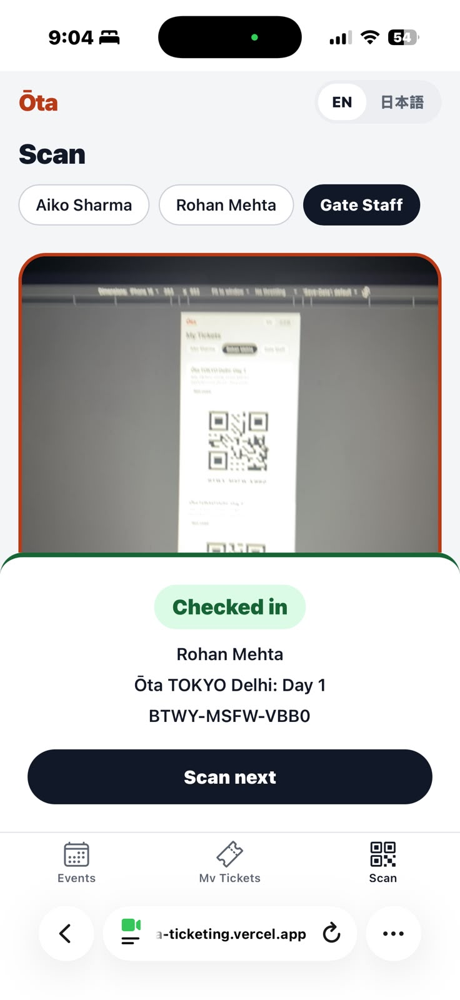
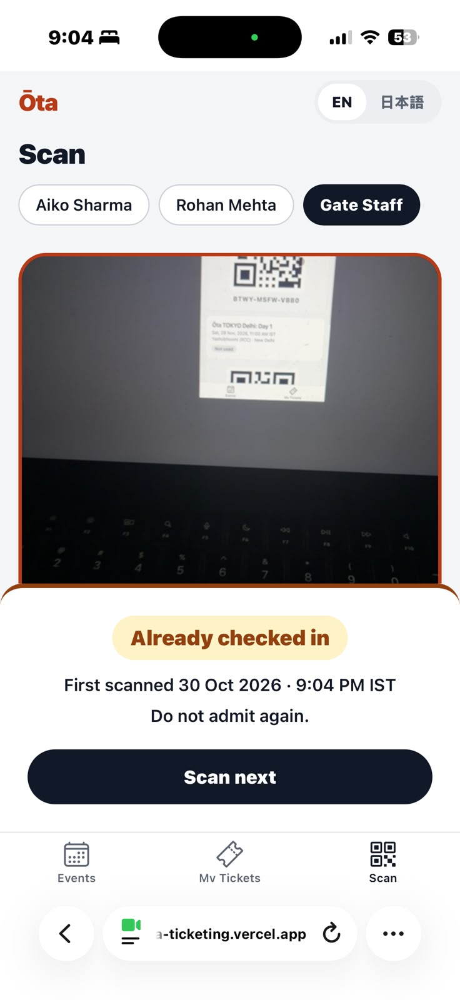

# Ōta Tickets

Mini ticketing for Ōta events: book a ticket, show it as a QR code, check it in at the gate.
Express + MySQL API, Expo (React Native) app for iOS, Android and web.

| | |
|---|---|
| Live web app | **https://ota-ticketing.vercel.app** (phone or desktop browser) |
| Live API | **https://ota-ticketing-api.vercel.app** (`/health` shows DB status) |
| Demo video | **https://www.loom.com/share/e96e1bd91b034dfaab33f0812152640a** (booking a ticket, the QR, gate check-in) |
| Stack | Node 24, Express 5, Prisma 7, MySQL 8 · Expo SDK 58, Expo Router, React Query, i18next |

## On a phone

The live site on an iPhone (Safari). Gate Staff scans a fan's QR from another screen: the first scan checks the
ticket in, and a second scan of the same QR is refused with the time of the first check-in.

<p>
  
  &nbsp;&nbsp;
  
</p>

## Test the live site (reviewers)

Open **https://ota-ticketing.vercel.app** on a phone or a laptop. Nothing to install, no account. There is no
login (the brief excludes it): pick a demo user from the chips at the top, and the app sends that user's ID as the
`X-User-Id` header.

| User | Role | Starts with |
|---|---|---|
| Aiko Sharma | Fan | 2 unused Day 1 tickets, 1 used ticket from a past event |
| Rohan Mehta | Fan | No tickets |
| Gate Staff | Staff | The only user who can check tickets in (the Scan tab appears only for them) |

### In the app (about 3 minutes)

1. **Browse:** 5 upcoming events with date (IST), venue, price (₹) and tickets left. "Ōta TOKYO Delhi: Day 2"
   shows **Only 2 left**; "Anime Fans Meetup" is **Sold out**.
2. **Book:** as **Rohan**, on Day 1 pick 1 to 4 with − / + and tap **Book now**. You land on **My Tickets**: one QR
   per ticket, its code as `XXXX-XXXX-XXXX` and a grey **Not used** badge. Back on Events, the count went down.
3. **No overselling:** book the last tickets of Day 2. The card turns **Sold out**; booking again says "Just sold
   out." With two devices (say phone and laptop, even as the same user), press **Book now** on the last ticket
   at the same moment: one gets it, the other is told it sold out.
4. **Check in:** keep a ticket's QR open on one screen. On a phone, switch to **Gate Staff** → **Scan** → allow the
   camera and point it at the QR (or type the code under the camera). First scan: green **Checked in** with the
   holder's name.
5. **Only once:** scan the same QR again → amber **Already checked in** with the time of the first scan.
6. **Back as the fan:** that ticket now shows **Checked in · HH:MM** and its QR fades (switch tabs to refresh).
7. **日本語:** tap the language pill. All UI text and dates switch to Japanese; event names stay as listed.

### The two rules from the API (about 1 minute)

Copy-paste into a terminal (bash or zsh). This changes the shared demo data: Day 2 stays sold out until the daily
reset.

```bash
API=https://ota-ticketing-api.vercel.app
ROHAN=4a12eeb9-cc9f-404c-9493-957d3bd4cffb
STAFF=cfc750b1-5c92-4710-8600-71d30c438c43
DAY1=b0772539-e91f-4237-b6d0-28a78d2f1fe4
DAY2=717f39ba-ce42-4e30-97a6-102b009f380b

# Rule 1, no overselling: 20 bookings for Day 2 fired at the same moment.
for i in $(seq 1 20); do
  curl -s -o /dev/null -w "%{http_code}\n" -X POST $API/events/$DAY2/book \
    -H "X-User-Id: $ROHAN" -H "Content-Type: application/json" -d '{"quantity":1}' &
done | sort | uniq -c
# Expected with Day 2 at 2 left:   2 201   and   18 409   (if someone already bought them: 20 409, never more 201s than were left)

# Rule 2, check in once: book one ticket, then scan its code twice.
CODE=$(curl -s -X POST $API/events/$DAY1/book -H "X-User-Id: $ROHAN" -H "Content-Type: application/json" \
  -d '{"quantity":1}' | grep -o '"code":"[A-Z0-9]*"' | cut -d'"' -f4)
curl -s -X POST $API/checkins -H "X-User-Id: $STAFF" -H "Content-Type: application/json" -d "{\"code\":\"$CODE\"}"; echo
curl -s -X POST $API/checkins -H "X-User-Id: $STAFF" -H "Content-Type: application/json" -d "{\"code\":\"$CODE\"}"; echo
# Expected: first {"ticket":{...}}, second 409 {"error":{"code":"ALREADY_CHECKED_IN",...,"details":{"checkedInAt":"<first scan>"}}}
```

More requests (validation, 403 for fans checking in, sold-out and past events) are under [API](#api).

### Good to know

- **Shared data, reset daily.** Every reviewer uses the same database; it resets to the seed every day around
  06:00 IST. If Day 2 is already sold out, book Cosplay Craft Workshop or Japanese Calligraphy Session instead.
- **First request may be slow.** The API is serverless; after a quiet spell the first load can take a few
  seconds. If you see "Can't connect right now", tap **Retry**. If it persists, check
  https://ota-ticketing-api.vercel.app/health (it reports whether the database is up).
- **Rate limit:** 30 bookings / check-ins per minute per client. The race above stays under it.
- **Camera:** works in phone browsers because the site is HTTPS. On a laptop, type the code instead.
- **Identity is a demo header, not security.** Anyone can act as any demo user, including Gate Staff; real login
  would replace it.
- **Run it yourself:** everything also runs locally (next section).

## Run it locally

Needs Node 24 and Docker.

```bash
git clone https://github.com/2arnav4/ota-ticketing && cd ota-ticketing
docker compose up -d --wait                      # MySQL 8.4 on :3306 (databases: ota, ota_test)

cd api
cp .env.example .env                             # local values already point at the Docker MySQL
npm install
npx prisma migrate deploy                        # creates tables + the ticketsLeft >= 0 CHECK
npm run db:seed                                  # 3 users, 6 events, 3 tickets (re-run any time to reset)
npm run dev                                      # API on http://localhost:4000
npm test                                         # Jest against ota_test (real MySQL, no mocks)

cd ../app                                        # second terminal
npm install
npx expo start                                   # press w for web, or scan the QR with Expo Go (SDK 58)
```

On a phone (Expo Go), the app reaches the API through the Mac's LAN IP automatically (same Wi-Fi needed).
On iOS, Expo Go must be signed in to the same Expo account as `npx expo login` on the Mac.

## API

All routes except `/health` need `X-User-Id: <seeded user UUID>`. Errors always look like
`{ "error": { "code": "SOLD_OUT", "message": "...", "details": {} } }`.

| Route | Does | Main statuses |
|---|---|---|
| `GET /health` | DB reachability | 200, 503 |
| `GET /events` | Upcoming events: venue, date, price (paise), tickets left | 200, 400, 401 |
| `POST /events/:id/book` `{ "quantity": 1-4 }` | Books tickets, never oversells. Optional `Idempotency-Key: <uuid>` header: a resend with the same key returns the original tickets (`Idempotent-Replayed: true`) instead of booking again | 201, 400, 404, 409, 422 (key reused for a different booking), 429 |
| `GET /me` | Current demo user and role | 200 |
| `GET /me/tickets` | My tickets with event details and check-in status | 200 |
| `POST /checkins` `{ "code": "..." }` | Staff only. Checks a ticket in once | 200, 403, 404, 409 (+ original time), 429 |

```bash
AIKO=0a8f8a3c-cb83-4ecf-8358-588b03249b38
ROHAN=4a12eeb9-cc9f-404c-9493-957d3bd4cffb
STAFF=cfc750b1-5c92-4710-8600-71d30c438c43
DAY2=717f39ba-ce42-4e30-97a6-102b009f380b
API=http://localhost:4000

curl -s $API/events -H "X-User-Id: $ROHAN"
curl -s -X POST $API/events/$DAY2/book -H "X-User-Id: $ROHAN" -H "Content-Type: application/json" -d '{"quantity":3}'
#   409 {"error":{"code":"NOT_ENOUGH_LEFT","message":"Only 2 left","details":{"ticketsLeft":2,"requested":3}}}
curl -s -X POST $API/events/$DAY2/book -H "X-User-Id: $ROHAN" -H "Content-Type: application/json" -d '{"quantity":2}'
curl -s $API/me/tickets -H "X-User-Id: $AIKO"
curl -s -X POST $API/checkins -H "X-User-Id: $STAFF" -H "Content-Type: application/json" -d '{"code":"7K3M-9QX2-RB4D"}'
curl -s -X POST $API/checkins -H "X-User-Id: $STAFF" -H "Content-Type: application/json" -d '{"code":"7K3M-9QX2-RB4D"}'
#   409 {"error":{"code":"ALREADY_CHECKED_IN",...,"details":{"checkedInAt":"..."}}}
curl -s -X POST $API/checkins -H "X-User-Id: $AIKO" -H "Content-Type: application/json" -d '{"code":"P8W2-H6TJ-5NC1"}'
#   403 FORBIDDEN (fans can't check in)
```

## How overselling is prevented

**In short:** booking is one conditional `UPDATE … SET ticketsLeft = ticketsLeft - qty WHERE ticketsLeft >= qty`
inside a transaction, so MySQL's row lock makes concurrent bookings queue and re-check the real stock; if no row
changed, the booking is refused with 409. A `CHECK (ticketsLeft >= 0)` constraint backstops it. Check-in uses the
same pattern (`WHERE checkedInAt IS NULL`), so a ticket can only be checked in once.

In detail, check and decrement are **one statement**, inside a transaction:

```sql
UPDATE Event SET ticketsLeft = ticketsLeft - :qty
WHERE id = :id AND ticketsLeft >= :qty AND startsAt > NOW();
```

InnoDB locks the event row while this runs. A concurrent booking waits, then re-evaluates the `WHERE` against
the committed value, so there is no read-then-write gap to race through, on any number of API instances.
If 0 rows changed, the API looks up why and answers 404 / 409 `SOLD_OUT` / `NOT_ENOUGH_LEFT` / `EVENT_STARTED`.
Otherwise it inserts the tickets in the same transaction. A `CHECK (ticketsLeft >= 0)` constraint backstops it
at the database level. "Node is single-threaded" would not be a fix: every `await` yields, and serverless runs
many instances.

Check-in uses the same idea: `UPDATE Ticket SET checkedInAt = NOW() WHERE code = ? AND checkedInAt IS NULL`.
Exactly one of several simultaneous scans changes a row; the rest get 409 with the first scan's time.

Proven by tests (`api/tests/booking.test.ts`, `checkins.test.ts`, and the Gauntlet below): 10 parallel bookings
on a 2-left event → exactly 2 succeed; 5 parallel scans of one code → exactly 1 succeeds.

## Design notes

- **Bookings made offline are queued, never faked.** With no connection, the app saves the booking on the device
  and shows it as *Pending · will book when you're back online*; it is sent automatically on reconnect (even after
  the app was closed) and a banner reports the result, including "sold out while you were offline". Each tap
  carries one `Idempotency-Key`, so a retry after a lost reply returns the same tickets and can't book twice. The
  resend still goes through the same guarded `UPDATE`, so the offline queue can't oversell either. The last loaded
  events and tickets stay viewable offline (QR codes included).
- **Money** is integer paise (₹349 = `34900`), formatted only at the edge with `Intl.NumberFormat('en-IN')`.
- **Times** are stored in UTC and shown in IST (`Asia/Kolkata`) in both languages.
- **Ticket codes** are 12 Crockford base32 characters from the CSPRNG (60 bits): unguessable, and no I/L/O/U, so
  they can be typed at the gate. The QR holds only the code. All primary keys are UUIDs.
- **Layers:** routes → controllers (parse, call, respond) → services (rules, no `req`/`res`) → Prisma.
  Input is validated with zod only at the boundary; bodies are strict (unknown fields → 400).
- **Event data:** the two "Ōta TOKYO Delhi" events use the real listing's dates, venue and ₹349 price. All
  other events are invented demo data.

## Tests

```bash
cd api && npm test        # 97 Jest tests, real MySQL test DB
cd app && npm test && npm run typecheck && npm run lint
cd api && npm run race    # 20 simultaneous bookings on the 2-left event: exactly 2 must win (local only)
cd api && npm run dev:logs   # API with readable logs: one line per booking, check-in and rejection
```

- `GAUNTLET.md`: concurrency, load and security test results.
